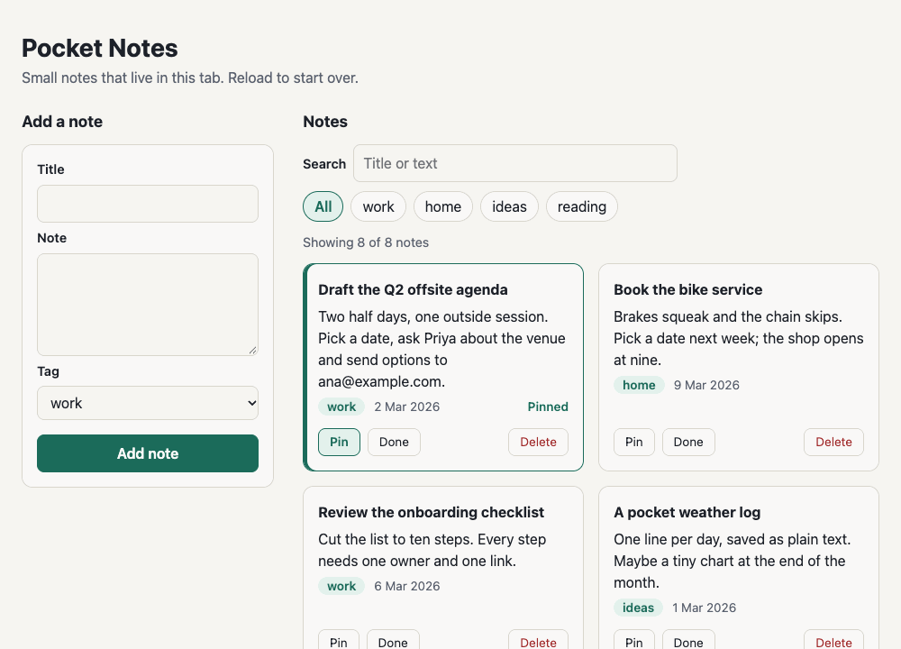
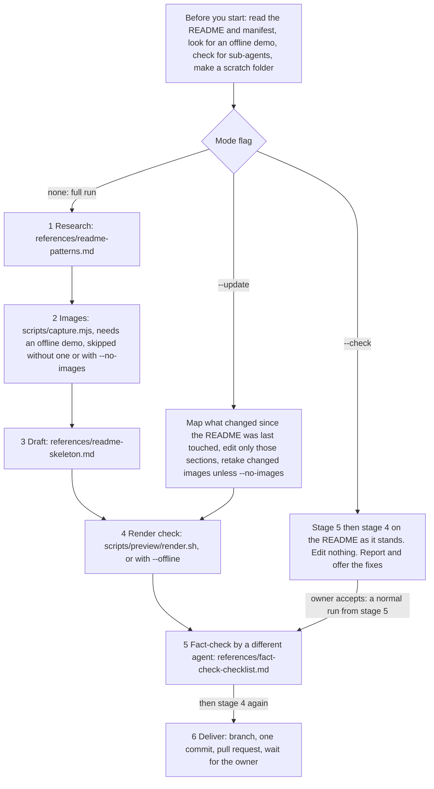
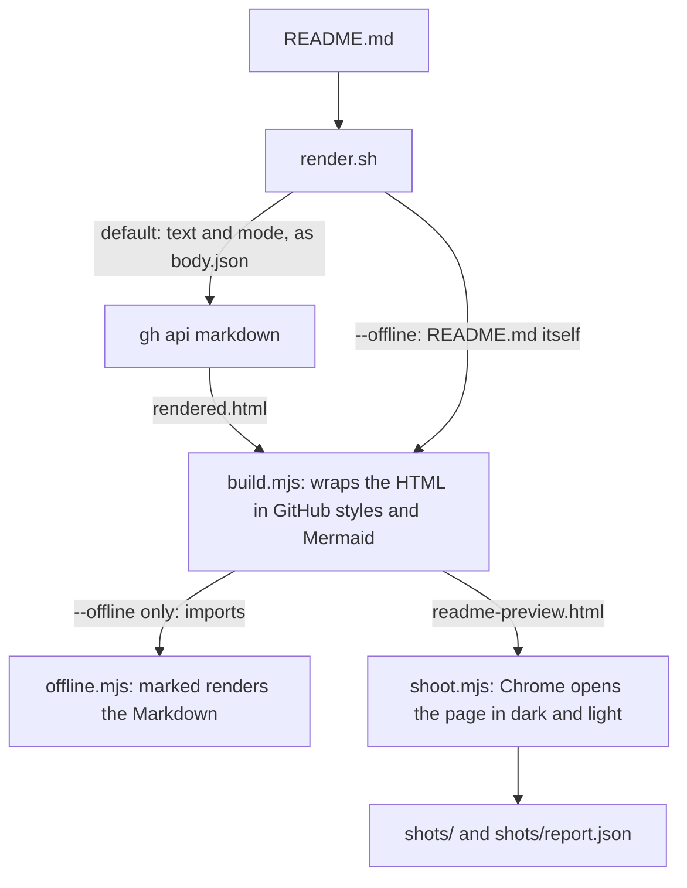
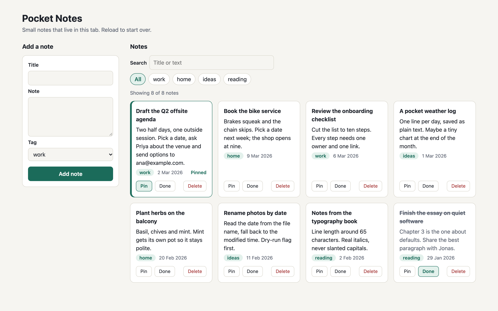
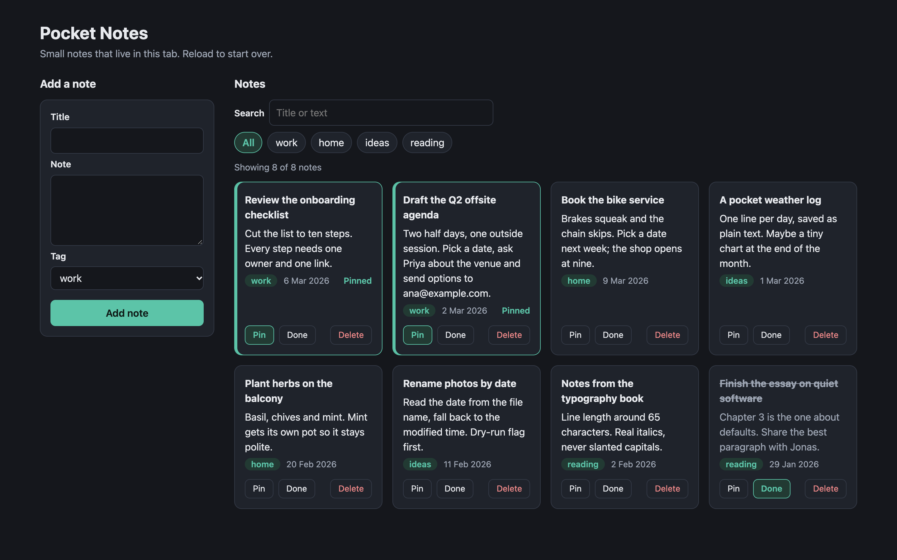
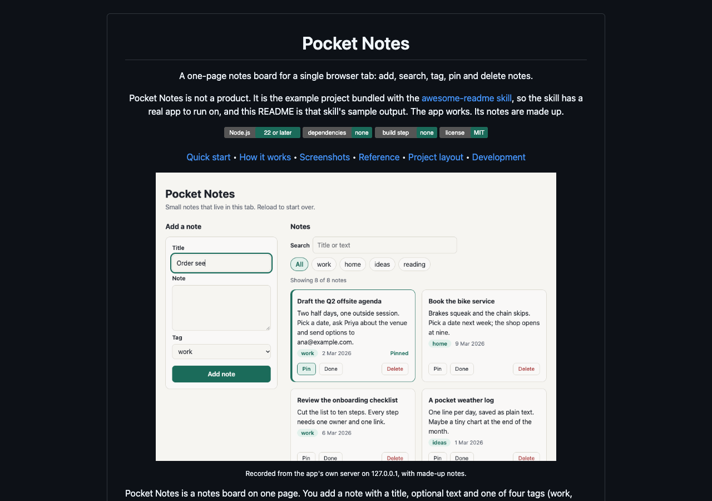
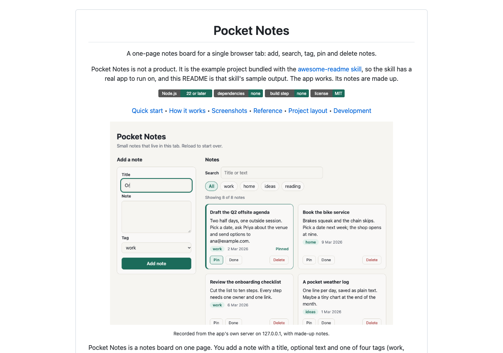

<h1 align="center">awesome-readme</h1>

<p align="center">An agent skill that writes a project README in six stages, and checks every checkable statement in it against your code.</p>

<p align="center">
    
</p>

<p align="center"><a href="#install">Install</a> • <a href="#for-ai-agents">For AI agents</a> • <a href="#use">Use</a> • <a href="#what-leaves-your-machine">What leaves your machine</a> • <a href="#how-it-works">How it works</a> • <a href="#project-layout">Project layout</a> • <a href="#development">Development</a></p>

<p align="center">
  
  <br>
  <sub>Real output of this skill's own capture tool (<code>scripts/capture.mjs</code>), run on the bundled example app, Pocket Notes. The app ran offline on <code>127.0.0.1</code> with fictional notes. This repository has no screen of its own, so this is the kind of GIF the skill makes for your project.</sub>
</p>

awesome-readme is an agent skill: a folder with a `SKILL.md` file that tells an AI coding agent how to do one job, here writing a project README. It follows the open Agent Skills standard ([agentskills.io](https://agentskills.io)) and passes that standard's reference validator, and it is also packaged as a Claude Code plugin. You give it a repository path. It researches a README shape, takes a demo GIF and screenshots from your project's own offline demo if it has one, drafts the README, previews it close to how GitHub draws it, has a different agent check every checkable statement against the code (a separate pass if the agent has no sub-agents), and opens a pull request that waits for you. Its rules say not to change your code, config or tests (the one exception is the capture config that a refresh run may change when an image no longer fits), and to keep its helper npm packages in a scratch folder outside your repository.

<details>
<summary>Contents</summary>

- [Use it when, and when not to](#use-it-when-and-when-not-to)
- [Install](#install)
- [For AI agents](#for-ai-agents)
- [Use](#use)
- [What leaves your machine](#what-leaves-your-machine)
- [Requirements](#requirements)
- [How it works](#how-it-works)
- [Example output](#example-output)
- [Project layout](#project-layout)
- [Development](#development)
- [Credits](#credits)
- [License](#license)

</details>

## Use it when, and when not to

Use it when you want:

- **A first screen a stranger can read.** The draft follows `skills/awesome-readme/references/readme-skeleton.md`: a hero with at most four badges, a demo GIF when there is a demo, a use-when list and a quick start of three commands or fewer.
- **Sentences checked against the code.** A different agent from the writer checks the finished README (stage 5), and the writer hands over a list of claims it could not confirm.
- **Real pictures.** The GIF and screenshots come from a demo instance running on your machine. The skill's rules forbid mocked screenshots.
- **A look at the page before you push.** A render check draws the README in a dark and a light theme and lists layout problems.
- **An audit or a small refresh.** `--check` reports what is wrong and changes nothing. `--update` edits only the sections the code has outgrown.

Do not use it when you need:

- **Images of a service that only runs online.** The capture tool takes pictures of a local demo and refuses a non-local address unless `--allow-remote` is given. With no demo instance, or for a project with no screen such as a CLI or a library, the skill skips the images and shows real output of the project's own tools on a bundled example instead.
- **A merge with no human.** The skill opens a pull request and waits for the owner. Its rules say never to merge it.
- **More than a README.** It does not write an API reference, a documentation site or a changelog.

## Install

For Claude Code, install the plugin. It needs Claude Code (the test used 2.1.325).

```sh
claude plugin marketplace add harshaanNihal/awesome-readme-skill
claude plugin install awesome-readme@awesome-readme-skill
```

Other agents have other routes. "Run" in the table means the command was executed. All the runs were made on 16 November 2026, before this repository was public, so they used the owner's git credentials. They installed commit `1070408`, then the head of `main`. The skill's scripts and instructions have changed since that commit, so the table records what happened with that commit, not a check of the version you are reading. The runs used Claude Code 2.1.325, `skills` CLI 1.9.0, GitHub CLI 2.100.0 and OpenCode 1.18.22. For the routes that install files, the installed `skills/awesome-readme` folder was compared with that commit's folder: all 13 files matched byte for byte (the `gh` route differs only in the front matter of `SKILL.md` and one blank line after it), and `node --check scripts/capture.mjs` passed at the installed location.

| # | Route | Tested | What the test showed |
|---|---|---|---|
| 1 | Claude Code plugin, two commands | Run | Both commands exit 0, and `claude plugin list` shows the plugin enabled at user scope. Installing needs no Claude login. The plugin cache holds the whole repository, because the plugin source is `./`. |
| 2 | Claude Code plugin, one command | Run | Exit 0. It adds the marketplace and installs. The Claude Code docs say this form needs Claude Code 2.1.292 or later. |
| 3 | `skills` CLI, install | Run | Exit 0 with `-a claude-code -a codex`. Project scope by default. Real files land in `.agents/skills/awesome-readme/` and `.claude/skills/awesome-readme` is a symlink to it. It writes `skills-lock.json` in the project. |
| 4 | `skills` CLI, list only | Run | Prints "Found 1 skill" and the skill's description. Installs nothing. |
| 5 | GitHub CLI (`gh skill`) | Run | Exit 0. A preview feature, see the note below the table. |
| 6 | Codex | Partly | The installer script ran with an extra `--dest <scratch folder>`, so it did not write to the real `~/.codex/skills`. Without `--dest` it installs there, for the user, and that was not run. The `$skill-installer` form inside Codex is from the Codex docs and was not run. |
| 7 | OpenCode | Discovery only | OpenCode has no installer. It reads `.agents/skills/`, so route 3 covers it, and `opencode debug skill` listed `awesome-readme` with its description. No model call was made. |
| 8 | Manual copy | Partly | The `git clone` ran, and a copy of the cloned folder passed the standard's validator, `skills-ref validate`. The copy command itself was not recorded. The `cp -R` below is the ordinary form, not a logged command. |
| 9 | Gemini CLI | Not run | `gemini` is not installed on the test machine. The command comes from the Gemini CLI documentation. |
| 10 | Cursor, VS Code Copilot | Not run | They have no installer of their own. They are expected to read `.agents/skills/` or `.claude/skills/` in a project, which route 3 fills. Loading the skill inside those editors was not tested. |

```sh
# 1. Claude Code plugin, two commands
claude plugin marketplace add harshaanNihal/awesome-readme-skill
claude plugin install awesome-readme@awesome-readme-skill

# 2. Claude Code plugin, one command
claude plugin install awesome-readme --marketplace harshaanNihal/awesome-readme-skill

# 3. skills CLI, for Claude Code and Codex, project scope
npx -y skills add harshaanNihal/awesome-readme-skill -a claude-code -a codex -y

# 4. skills CLI, list the skill without installing it
npx -y skills add harshaanNihal/awesome-readme-skill --list

# 5. GitHub CLI
gh skill install harshaanNihal/awesome-readme-skill awesome-readme

# 6. Codex, installer script (user level, into ~/.codex/skills)
python3 ~/.codex/skills/.system/skill-installer/scripts/install-skill-from-github.py \
  --repo harshaanNihal/awesome-readme-skill --path skills/awesome-readme

# 7. OpenCode has no installer: route 3 puts the skill where it looks

# 8. Manual copy: clone, then copy skills/awesome-readme into the agent's skills folder
git clone https://github.com/harshaanNihal/awesome-readme-skill.git
cp -R awesome-readme-skill/skills/awesome-readme <skills folder>/

# 9. Gemini CLI (not run)
gemini skills install https://github.com/harshaanNihal/awesome-readme-skill \
  --path skills/awesome-readme
```

Inside a Claude Code session, the commands of route 1 are typed as `/plugin marketplace add harshaanNihal/awesome-readme-skill` and `/plugin install awesome-readme@awesome-readme-skill`. That form is from the Claude Code docs and was not run. For route 3, `--copy` makes real copies instead of the symlink (it was run once, and it wrote the skill into both folders). `-g` installs for the user instead of the project, and leaving out `-a` lets the CLI detect your installed agents. Those last two were not run. The `skills` CLI needs Node.js 22.20.0 or later (the test ran Node 24). Skills folders for a manual copy: `~/.claude/skills/` or `.claude/skills/` for Claude Code, and `~/.agents/skills/` or `.agents/skills/` for most other agents.

> [!NOTE]
> `gh skill` is a preview feature of the GitHub CLI. It rewrites the front matter of the installed `SKILL.md` (it sorts the keys and adds `metadata.github-path`, `github-ref`, `github-repo` and `github-tree-sha`) and records the install in `~/.agents/.skill-lock.json`, a file in your home folder. Below the front matter the text is the same except that the blank line after the front matter is dropped. Every other file stays identical, and the result still passes the standard validator. By default it installs into the project at `.agents/skills/awesome-readme`. `--agent claude-code` installs to `.claude/skills/awesome-readme`, and `--dir <folder>` installs to a folder you name. With no tagged release it installs the head of the default branch, and once a tagged release exists it installs the latest one. The test ran it with `gh` logged in.

> [!WARNING]
> Installing a skill means trusting its scripts, which run with your agent's permissions. Read `skills/awesome-readme/SKILL.md` and the scripts in `skills/awesome-readme/scripts/` before you install. The GitHub CLI warns: "Skills are not verified by GitHub and may contain prompt injections, hidden instructions, or malicious scripts. Always review skill contents before use." The `skills` CLI warns: "Review skills before use; they run with full agent permissions." The section [What leaves your machine](#what-leaves-your-machine) lists what the scripts send.

## For AI agents

If a user asks you to install this skill from `https://github.com/harshaanNihal/awesome-readme-skill`, do this.

1. Install one folder, `skills/awesome-readme`, whole, and keep the folder name `awesome-readme`. The `name` in its `SKILL.md` must match the folder name. Do not install the repository root: there is no `SKILL.md` there on purpose.
2. Read `skills/awesome-readme/SKILL.md` and the files in `skills/awesome-readme/scripts/` first. Tell the user that the scripts run with your permissions and what they send, as listed in [What leaves your machine](#what-leaves-your-machine).
3. Clone the repository into a scratch folder, not into the user's project: `git clone https://github.com/harshaanNihal/awesome-readme-skill.git`. If you are Claude Code, you can run the two plugin commands from the install section instead. The plugin copies the whole repository into its cache.
4. Copy `awesome-readme-skill/skills/awesome-readme` to the folder your agent reads skills from, so that `awesome-readme/SKILL.md` exists inside it.
   - Claude Code: `~/.claude/skills/` for all projects, or `.claude/skills/` for this project.
   - Codex: `~/.codex/skills/`, where its own installer script writes, or `.agents/skills/`, where the `skills` CLI writes for Codex.
   - OpenCode and most other agents: `~/.agents/skills/` or `.agents/skills/`.
   - Gemini CLI: run `gemini skills install https://github.com/harshaanNihal/awesome-readme-skill --path skills/awesome-readme` (this command was not run in testing).
   - Any other agent: find its skills folder in its documentation. If you cannot, ask the user. Do not guess.
5. Confirm it loaded:
   ```sh
   # prints nothing if the copy is exact
   diff -r awesome-readme-skill/skills/awesome-readme <skills folder>/awesome-readme
   # exits 0
   node --check <skills folder>/awesome-readme/scripts/capture.mjs
   ```
   Then check that your agent lists `awesome-readme` among its skills. In OpenCode, `opencode debug skill` lists it. After a Claude Code plugin install, `claude plugin list` shows the plugin. If it does not show up, start a new session and look again. A `gh skill install` copy differs from the repository in its front matter, so `diff -r` reports that file.
6. Tell the user which route you used. Do not install the skill's helper npm packages now: the skill installs them in a scratch folder when it runs.

## Use

```text
/awesome-readme [repo-path] [--no-images] [--check | --update] [--offline]
```

That line is the argument hint in the front matter of `SKILL.md`. Per the Claude Code docs, plugin skills are namespaced, so installed as a plugin the full name is `/awesome-readme:awesome-readme`, and the short name also works unless another command has that name. No model session was started to test either name. You can also ask in words, such as "write a README for this repo". The skill's description covers requests to write or improve a README, and `SKILL.md` counts "is my README still accurate?" as `--check`, "the code changed, bring the README up to date" as `--update`, and words about keeping things local, such as "nothing may leave my machine", as `--offline`.

| Way | Use it when | What it touches |
|---|---|---|
| Full run (no mode flag) | There is no README, its shape is wrong, or you ask for a rewrite | The README, the images, a branch and a pull request |
| `--check` | You have a README and want to know what in it is wrong | Nothing in the repository. The result is a report |
| `--update` | The README was right once and the code has moved on | The stale sections, the images whose screen changed, a branch and a pull request |

| Argument | Effect |
|---|---|
| `repo-path` | The repository to work on. Default: the current repository. |
| `--no-images` | Skips stage 2. With `--update` it means: do not retake images. |
| `--check` | Audit only: no edit, commit, branch or pull request. It returns a report with the wrong statements and corrected wording, the statements it could not confirm, layout problems, totals, and code problems it noticed. |
| `--update` | Edits only the sections the code changes made stale, keeps the structure and voice, retakes only the images whose screen changed, then runs the render check, a fact-check of the whole README, and delivery. |
| `--offline` | Renders the stage 4 preview locally with no GitHub and no network, and skips the stage 5 link and badge fetches, listing those URLs as unchecked. See [What leaves your machine](#what-leaves-your-machine). |

`--check` and `--update` do not combine: asked for both, the skill runs `--check` and offers the update at the end. `--offline` and `--no-images` go with any mode. With no README, `--check` and `--update` have nothing to work on, so the skill does a full run.

> [!TIP]
> If you are not sure the README needs a rewrite, start with `--check`. It changes nothing in the repository.

The rules in `SKILL.md` tell the agent to take screenshots only from the demo instance, never to call a service the project integrates with in order to show or verify a feature, never to put real personal data in an image or the README, never to change code, config or tests in the repository (an `--update` run may change the kept capture config when a shot no longer fits, and says so in the pull request), never to put helper packages in it, and never to merge the pull request itself. These are instructions to the agent. Code enforces only a few of them: the capture tool's address and origin checks and its host resolver rule, and the preview scripts' request blocking, described next.

## What leaves your machine

Your agent sends what it reads to its own model provider. The scripts in this skill do not control that. The table lists what the skill's own steps send, taken from the scripts. It agrees with the "What leaves the machine" table in `SKILL.md`.

| Step | What is sent | To where |
|---|---|---|
| Install | The skill is downloaded. The `npx` routes also download the `skills` CLI. | GitHub, and the npm registry for `npx` |
| 1 Research | Nothing. Only when the research is refreshed (on request, or when the project is a different kind of thing from the sample) does the agent download public README files by URL. Nothing from your project is in those requests. | `raw.githubusercontent.com` |
| 2 Images, packages | `npm i puppeteer-core gifenc pngjs omggif` in the scratch folder. The four packages are not pinned to a version. The render check needs `puppeteer-core` in the same folder, installed the same way when stage 2 did not do it. | The npm registry |
| 2 Images, capture | Nothing from your repository. The tool aborts every page request to an origin other than the demo's. A loopback-only run (no `--allow-remote` and no `allowOrigins`) also starts Chrome with a host resolver rule that fails every host name except loopback, so Chrome's own requests cannot leave either. If a run allows remote origins, that rule is off and Chrome can make a few startup requests of its own. They carry nothing from your project. | Your own machine for the demo. Only when remote origins are allowed, also the browser vendor's hosts (Google's, for Chrome) for Chrome's own requests |
| 3 Draft | Nothing from the skill's scripts. | None |
| 4 Render check, default | The whole README text and the mode `markdown`, sent with your `gh` login, and nothing else from your repository. Chrome then loads github-markdown-css 5.8.1 and Mermaid 11.4.1 by URL, and those two requests carry no README text. Chrome's own startup requests also happen, and they carry nothing from the README. | GitHub's Markdown API through `gh api markdown`, then `cdnjs.cloudflare.com` and `cdn.jsdelivr.net`. The browser vendor's hosts (Google's, for Chrome) for Chrome's own requests |
| 4 Render check, `--offline` | Nothing, once the packages are installed. Chrome's own startup requests are tried and fail at name resolution. The one-time install is `npm i marked@18.2.0 github-markdown-css@5.8.1 mermaid@11.4.1`. | The npm registry, for that install only |
| 5 Fact-check | A plain GET or HEAD request, without credentials, for each URL that the README links or embeds (documentation links and badge images). Each request names a URL that is already in the README and sends nothing from your project. The hard rules forbid calling a service the project integrates with to check a feature. | The hosts in those URLs. With `--offline` none, and the URLs are listed as unchecked |
| 6 Deliver | The branch with the README and the images, pushed so that a pull request can be opened, and the pull request text. | Your git remote, and GitHub |

**The capture tool (stage 2).** `capture.mjs` refuses a base URL that is not loopback (`127.0.0.1`, `localhost` or `[::1]`) unless `--allow-remote` is given. It aborts every page request whose origin is not the demo's, lets `data:`, `about:` and `blob:` through, counts what it aborted and prints the list at the end. Chrome starts with `--disable-background-networking` and `--disable-component-update`. They do not stop everything: the tool's header says Chrome can still make a few startup requests of its own, with no page open, and the page interception cannot see them. So a loopback-only run, one with no `--allow-remote` and no `allowOrigins` in the config, also starts Chrome with `--host-resolver-rules="MAP * ~NOTFOUND , EXCLUDE 127.0.0.1 , EXCLUDE localhost , EXCLUDE ::1"`. Every host name except loopback then fails to resolve, so Chrome reaches nothing but the demo. With `--allow-remote`, or with any `allowOrigins` entry (extra origins a config can allow), the rule is off and Chrome's own startup requests are possible. They carry nothing from your project. The bundled example's `capture.json` allows no extra origin, so its run is loopback-only. The tool also starts the `server` command from the config. For the example that is `node serve.mjs`, which listens on `127.0.0.1` only. That command is your project's own code running on your machine.

**The render check, default mode (stage 4).** `render.sh` writes the README text and the mode into `body.json` and posts it with `gh api markdown`, which needs `gh` logged in and makes the request with that login. Chrome then loads the stylesheet from `cdnjs.cloudflare.com` and Mermaid from `cdn.jsdelivr.net`, and those two requests carry no README text. `shoot.mjs` aborts every other page request and lists it as a problem. In both modes Chrome starts with `--disable-background-networking` and `--disable-component-update`. They do not stop everything. The header of `shoot.mjs` records that Chrome 157 still made four startup requests of its own, to Google hosts, the same with no README open. The page interception cannot see them, and they carry nothing from the README. Only `--offline` stops them.

**The render check, `--offline`.** It avoids the network use above:

- It needs no `gh`. `marked` renders the Markdown on your machine, and the stylesheet and Mermaid are read from `node_modules` in the scratch folder.
- Chrome starts with the same two flags as in the default mode and also with `--host-resolver-rules=MAP * ~NOTFOUND`, so every host name fails to resolve, Chrome's own startup requests included. Every page request that is not `file:`, `data:` or `about:` is aborted, and any such request fails the run and lists the URLs.
- A missing package makes `render.sh` print the `npm i` line and exit 2.

What it gives up. It is an approximation of GitHub, looser than the default mode:

- No syntax colours, emoji shortcodes, `@mentions` or `#issue` links, footnotes, math, relative-link rewriting or heading permalinks.
- Heading ids are computed locally. The computed id can miss the trailing hyphen GitHub adds after a heading that ends in an inline badge or comment.
- The sanitizer removes the elements `script`, `style`, `iframe`, `object`, `embed` and `form` that have a closing tag, with what is inside them, the `link`, `meta` and `base` tags, and the `style` and `on*` attributes, and nothing more. An opening tag with no closing tag is left alone. GitHub's sanitizer differs.
- Every remote image becomes a local placeholder and is not checked. The run prints how many.
- If you use it, the report must say that the default check was not run.

## Requirements

| Needs | For | Notes |
|---|---|---|
| An agent with file access and a shell | Every stage | From the `compatibility` line of `SKILL.md`. Sub-agents help, one per stage, but are not required. |
| Node.js 22.2 or later | Images | `capture.mjs` uses `zlib.crc32`, and its header says 22.2 or later. CI runs Node 22. |
| Node.js | Render check | `SKILL.md` says it was tested on Node 22. The scripts use top-level await. |
| Chrome or Chromium | Images, render check | Must already be installed. `lib.mjs` looks in the usual macOS, Linux and Windows places. Set `CHROME` to use another. |
| `puppeteer-core`, `gifenc`, `pngjs`, `omggif` | Images | `npm i` in a scratch folder, then `export README_TOOLS=<that folder>`. |
| `puppeteer-core` | Render check | In the same scratch folder. |
| `gh`, logged in, with network access | Render check, default mode | Used only to post the README text to GitHub's Markdown API. |
| `marked`, `github-markdown-css`, `mermaid` | Render check, `--offline` | Versions 18.2.0, 5.8.1 and 11.4.1, the ones `offline.mjs` tells you to install. It checks that the packages are present, not their version. No network once installed. |
| bash | Render check | `render.sh` is a bash script. |

This repository has no build step and no `package.json` at its root. The helper packages never go in it.

## How it works

The skill is a fixed sequence of six stages. The mode flags choose which of them a run uses.



- **One agent per stage, if there are sub-agents.** `SKILL.md` suggests a small fast model for stage 1, mid-tier models for stages 2 to 4 (a stronger one for stage 3 if the code is large), a mid-tier or stronger model for stage 5, and the orchestrating agent for stage 6. With no sub-agents the agent runs the stages in order, and stage 5 is still a separate pass: it reopens the files and checks each sentence fresh.
- **The fact-checker is never the writer.** The writer ends its report with a list titled "Claims I could not confirm". That list goes to the orchestrator and the checker, not into the README. The checker works through fixed areas (layout tree, commands, options, config and keys, features versus what is wired, privacy claims, diagrams node by node, exports and data paths, links and anchors, badge URLs, numbers, images, install and "tested" claims). It fixes the README, never the code, and reports code problems it finds.
- **Images need a demo instance.** `scripts/capture.mjs` drives Chrome against a local demo, writes screenshots and a GIF (frames are PNGs encoded with `gifenc`, no ffmpeg) and warns when the GIF is over its size limit. `scripts/verify-gif.mjs` decodes the GIF and prints its size, frame count and play time. The agent opens every image and rejects blank, half-loaded, cut-off and error states.
- **Layout is fixed in stage 4, facts in stage 5.** The render check changes layout only. Stage 4 runs again after the fact-check, because corrections change layout.
- **Delivery waits for you.** The README and the images go in one commit on a branch, and the pull request lists the fact-check's code problems and any claims still unconfirmed.

### The render check



`render.sh` runs these in order: `gh` (default mode only), `build.mjs`, then `shoot.mjs`. The arrows show what each step hands to the next, and `build.mjs` imports `offline.mjs` only with `--offline`. `shoot.mjs` lists Mermaid parse errors and diagrams that draw nothing, broken images, tall images outside `<details>`, anchors that match no heading, code blocks and tables wider than the column, and sideways page scroll. It exits 1 when it finds any.

> [!NOTE]
> The default render check is the closest preview of GitHub this skill can make. It is not an exact copy, and `--offline` is looser still. Use the preview to find layout problems, and check the page on GitHub when you can.

<details>
<summary>What still differs from github.com</summary>

The default mode, from the header of `scripts/preview/build.mjs`:

- Relative links and images resolve against the local folder, not the repository.
- Remote images and badges are replaced by local placeholders and are not checked. Verify their real URLs separately.
- Mermaid comes from a pinned CDN build (11.4.1), not GitHub's own renderer, so version and theme can differ.
- Callouts and task lists are rebuilt locally by regular expressions, because the Markdown API returns them as plain text.
- GitHub's client-side extras, such as copy buttons, `dir="auto"`, table wrappers and the icon in the heading permalink, are absent.
- The API moves the fallback `` of a dark and light `<picture>` out of the `<picture>`.
- Footnotes come back as a bare section without the "Footnotes" heading.

`--offline` adds the differences listed in [What leaves your machine](#what-leaves-your-machine).

</details>

## Example output

`examples/pocket-notes/` is a small notes app: add a note, search, filter by tag, pin, mark done and delete. Its notes live in memory, so a reload starts over. It is the demo instance for the GIF at the top and the two app screenshots below. Its README, [`examples/pocket-notes/README.md`](examples/pocket-notes/README.md), is what the skill produces for a project. Its images were made by `capture.json` next to it.

<p align="center">
  
  &nbsp;
  <br>
  <sub>Real output of <code>capture.mjs</code> on the example app, from one shot list. Left: light theme. Right: dark theme. The app follows the browser's colour setting.</sub>
</p>

<p align="center">
  <br>
  <br>
  <sub>The render check's own screenshots of the first screen of <code>examples/pocket-notes/README.md</code>, dark above and light below, from <code>scripts/preview/render.sh</code> in its default mode. They show only the first screen, not the whole page, and a local preview page, not github.com. GitHub's Markdown API renders the text, and github-markdown-css supplies GitHub's dark and light themes. The four badges are placeholders that the check draws locally and does not verify, because it replaces remote images. The demo GIF appears as whichever frame was playing, so it is a different frame in each image.</sub>
</p>

### How this README was made

This README was written by running the skill on its own repository, in this order: research, a draft, a render check, a fact-check by an agent other than the writer, and a pull request. The fact-check read each statement against the files in this repository, ran the repository's own checks, retook the example's images and compared them with the committed ones, and fetched each badge and documentation link in this README and in the example's README once. It did not run any install route, so the install table comes from the earlier test run described in [Install](#install). The render check was run again, in its default mode, after the fact-check's edits. Every image here is real output of the skill's own tools, because this repository has no screen of its own and the skill does not allow mocked screenshots.

## Project layout

```text
.
├── README.md                              this file
├── LICENSE                                MIT license text
├── .claude-plugin/
│   ├── plugin.json                        Claude Code plugin manifest, holds the version
│   └── marketplace.json                   one-plugin marketplace, plugin source is "./"
├── .github/workflows/
│   └── ci.yml                             CI: the check job and the smoke job
├── .gitignore                             ignores node_modules, .DS_Store and preview output
├── docs/images/
│   ├── render-check-dark.png              render check screenshot of the example README, dark
│   └── render-check-light.png             the same, light
├── examples/pocket-notes/                 demo app for the images, and a sample of the output
│   ├── README.md                          the example's README, written by the skill
│   ├── index.html                         the app's page
│   ├── app.js                             the app's logic, notes kept in memory
│   ├── styles.css                         styles that follow the system colour scheme
│   ├── serve.mjs                          static server, Node built-ins, 127.0.0.1 only
│   ├── package.json                       private package with a start script
│   ├── capture.json                       capture config: five screenshots and the GIF
│   └── docs/images/
│       ├── demo.gif                       the demo GIF
│       ├── hero.png                       light theme, first screen
│       ├── add-note.png                   after adding a note
│       ├── search.png                     a search for "date"
│       ├── tag-filter.png                 the ideas tag selected
│       └── dark-theme.png                 dark theme
├── skills/awesome-readme/                 the skill: this folder is what you install
│   ├── SKILL.md                           the skill's instructions and front matter
│   ├── LICENSE                            copy of the root LICENSE
│   ├── references/
│   │   ├── readme-patterns.md             stage 1 research: techniques from known READMEs
│   │   ├── readme-skeleton.md             stage 3: README shape and markup that renders
│   │   └── fact-check-checklist.md        stage 5 and --check: what to verify
│   └── scripts/
│       ├── capture.mjs                    stage 2: screenshots and GIF from a local demo
│       ├── capture.example.json           starting point for a capture config
│       ├── lib.mjs                        finds the helper packages and Chrome
│       ├── verify-gif.mjs                 decodes a GIF, prints size, frames, play time
│       └── preview/
│           ├── render.sh                  stage 4 entry point, default and --offline
│           ├── build.mjs                  wraps the rendered HTML in GitHub styles and Mermaid
│           ├── shoot.mjs                  Chrome screenshots and the layout checks
│           └── offline.mjs                local Markdown renderer for --offline, uses marked
└── tools/
    └── check-repo.mjs                     checks manifests, skill layout and front matter
```

The tree leaves out `.git/`. Helper packages and preview output live in a scratch folder, not here.

To read the code, start with these files in order:

1. `skills/awesome-readme/SKILL.md` for the flow, the modes and the rules.
2. `skills/awesome-readme/scripts/capture.mjs`. Its header lists every setting and step.
3. `skills/awesome-readme/scripts/preview/render.sh`. Its header says what each mode sends and points to the list of differences from GitHub in `build.mjs`.
4. `tools/check-repo.mjs` for what CI enforces about the manifests and the skill folder.

## Development

CI (`.github/workflows/ci.yml`) runs on every pull request and on pushes to `main`, with read-only permissions and Node 22. It has two jobs.

- **`check`** runs `node --check` on every `.mjs` file and `bash -n` on every `.sh` file, parses every `.json` file, runs `node tools/check-repo.mjs`, and runs `skills-ref validate skills/awesome-readme`. `skills-ref` is the reference validator of the Agent Skills standard. CI installs it with `uvx` from a commit of `agentskills/agentskills` that `ci.yml` pins.
- **`smoke`** runs the tools on a clean Ubuntu runner. It installs the helper packages into a folder under `$RUNNER_TEMP`, finds Chrome, and, when the runner has that setting, lifts its AppArmor limit on unprivileged user namespaces so that Chrome's sandbox can start (neither tool passes `--no-sandbox`). It captures the example with `capture.json` and checks that every image in the config exists and is not empty, runs `verify-gif.mjs` on the GIF, and renders `README.md` and `examples/pocket-notes/README.md` with `render.sh --offline` (a README that does not exist yet is skipped). It fails if the run left any change in the repository, ignored files included.

CI does not run the default render check, `claude plugin validate`, or any install route.

`node tools/check-repo.mjs` needs no network. It prints one problem per line and exits 1 if there is any. It checks that the two manifests parse and carry the fields it needs, that the marketplace has exactly one plugin entry with source `./` and no version, that there is no `SKILL.md` at the root and exactly one folder under `skills/`, that the skill's front matter has only allowed keys and a `name` equal to its folder, that `SKILL.md` is under 500 lines, that every `references/` or `scripts/` path it mentions in backticks exists, that the skill's `LICENSE` is identical to the root one, and that git tracks no `.DS_Store` or `node_modules`.

```sh
# the repository checks, no network
node tools/check-repo.mjs
# syntax check of one script, and of the shell script
node --check skills/awesome-readme/scripts/capture.mjs
bash -n skills/awesome-readme/scripts/preview/render.sh
# the plugin manifests, needs Claude Code
claude plugin validate . --strict
```

`claude plugin validate . --strict` exits 0. It prints one warning, that the plugin has no icon, and that warning does not change the result.

Validate the skill with the standard's own validator. This needs `uv` and the network.

```sh
ref=83021e2be457a9b6679148719c1f6074f0ad975e   # the commit pinned in .github/workflows/ci.yml
uvx --from "git+https://github.com/agentskills/agentskills@$ref#subdirectory=skills-ref" \
  skills-ref validate skills/awesome-readme
```

Run the main steps of the smoke job by hand from the repository root. This leaves out the GIF check and the check that the images exist. Port 4599 must be free, because the capture tool stops if something already answers there.

```sh
tools=$(mktemp -d)   # a scratch folder outside the repository
(cd "$tools" && npm init -y > /dev/null && npm i puppeteer-core gifenc pngjs omggif \
  marked@18.2.0 github-markdown-css@5.8.1 mermaid@11.4.1)
export README_TOOLS=$tools
(cd examples/pocket-notes && node ../../skills/awesome-readme/scripts/capture.mjs \
  --config capture.json --out "$tools/images")
bash skills/awesome-readme/scripts/preview/render.sh --offline README.md . "$tools/preview"
```

To look at the example app yourself, run `node serve.mjs` in `examples/pocket-notes` and open `http://127.0.0.1:4599/`.

**Release rule.** The plugin version lives only in `.claude-plugin/plugin.json`. The marketplace entry must not carry one, and `tools/check-repo.mjs` fails if it does. Claude Code keeps an installed plugin in a cache folder named after `version` (the test's folder ended in `1.0.0`), so bump `version` in the pull request that changes the skill. Whether Claude Code skips an update when `version` is unchanged was not tested. Nothing in this repository creates tags or releases.

## Credits

The skill uses these packages. None is bundled: they are installed from npm into a scratch folder when the skill runs.

- **Browser control:** [puppeteer-core](https://github.com/puppeteer/puppeteer) (Apache-2.0).
- **Images:** [gifenc](https://github.com/mattdesl/gifenc), [pngjs](https://github.com/pngjs/pngjs) and [omggif](https://github.com/deanm/omggif) (all MIT).
- **Preview:** [marked](https://github.com/markedjs/marked), [github-markdown-css](https://github.com/sindresorhus/github-markdown-css) and [mermaid](https://github.com/mermaid-js/mermaid) (all MIT).
- **Standard:** [Agent Skills](https://agentskills.io).

## License

MIT. See [LICENSE](LICENSE). The skill folder carries its own copy, `skills/awesome-readme/LICENSE`, and `tools/check-repo.mjs` fails if the two differ.
