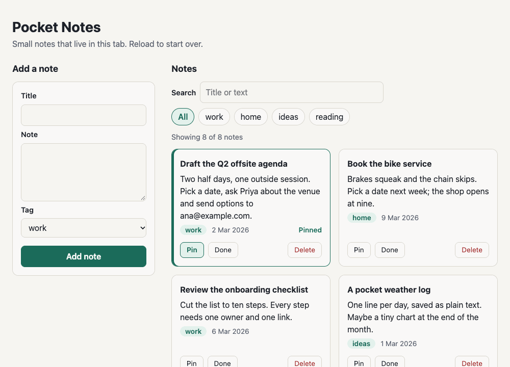
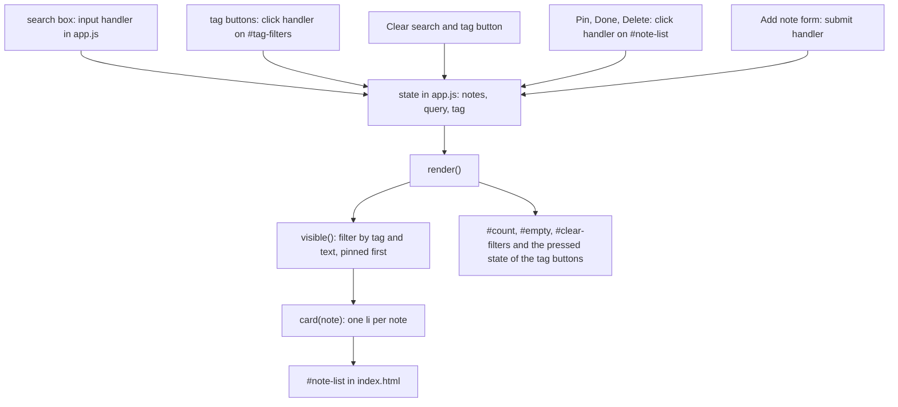
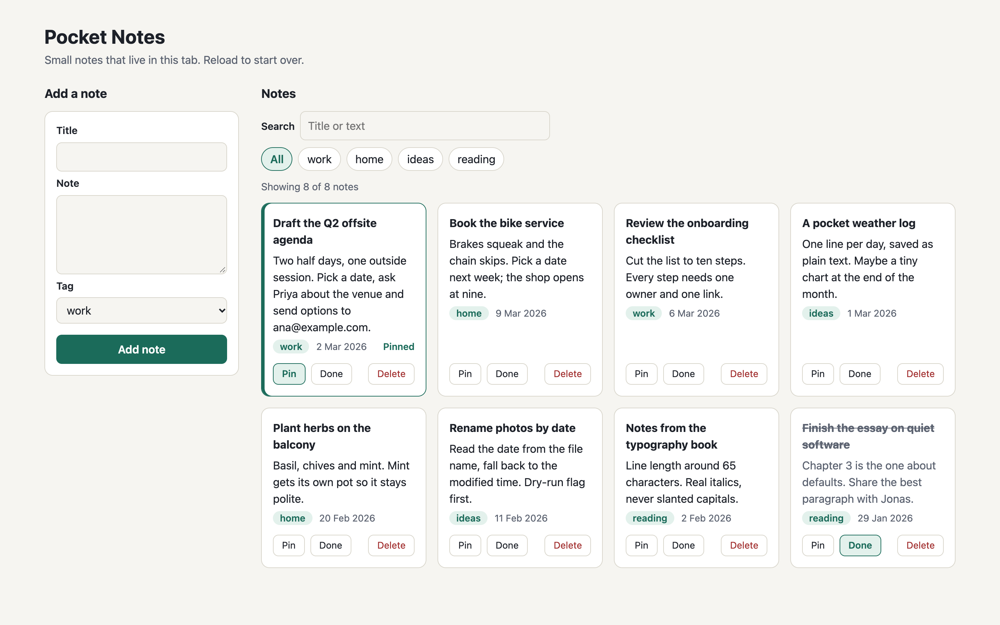
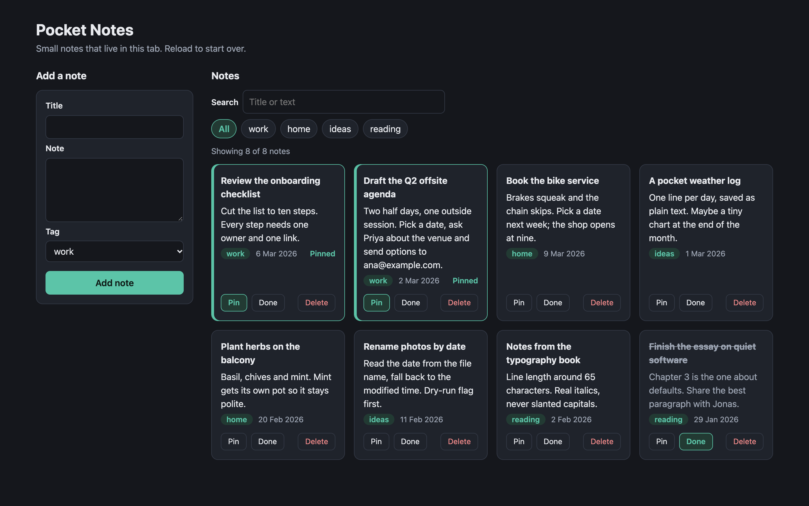
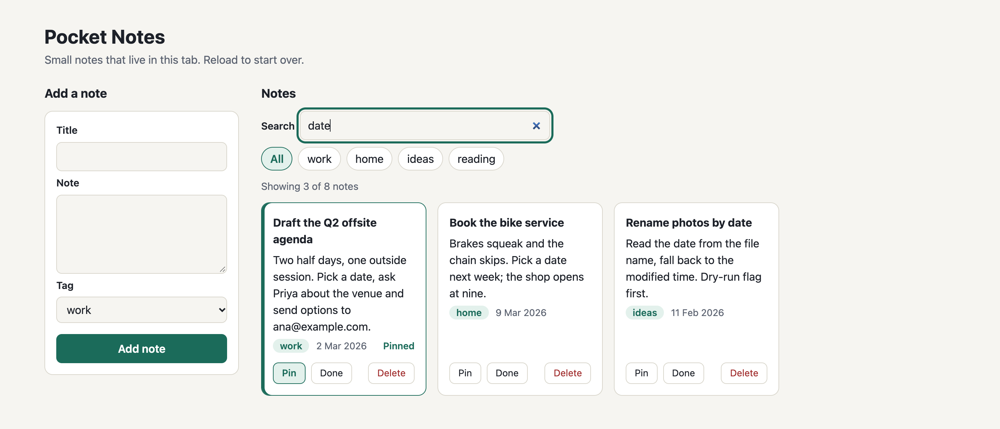
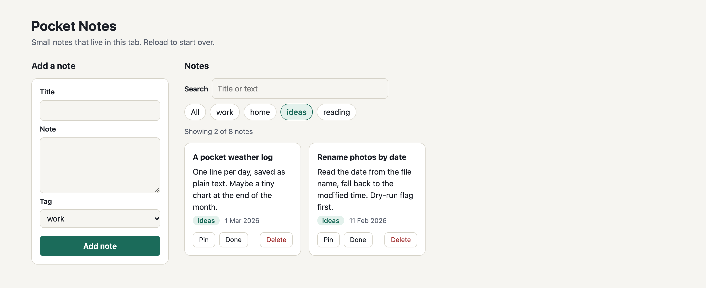
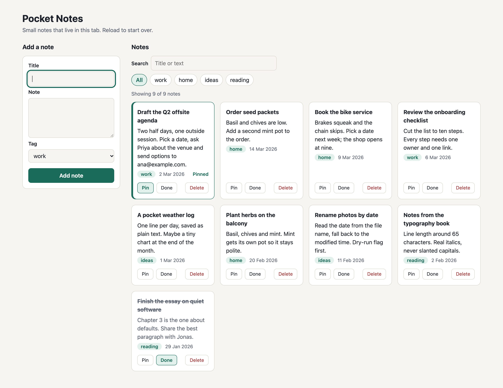

<h1 align="center">Pocket Notes</h1>

<p align="center">A one-page notes board for a single browser tab: add, search, tag, pin and delete notes.</p>

<p align="center">Pocket Notes is not a product. It is the example project bundled with the <a href="../../README.md">awesome-readme skill</a>, so the skill has a real app to run on, and this README is that skill's sample output. The app works. Its notes are made up.</p>

<p align="center">
     
</p>

<p align="center"><a href="#quick-start">Quick start</a> • <a href="#how-it-works">How it works</a> • <a href="#screenshots">Screenshots</a> • <a href="#reference">Reference</a> • <a href="#project-layout">Project layout</a> • <a href="#development">Development</a></p>

<p align="center">
  
  <br>
  <sub>Recorded from the app's own server on 127.0.0.1, with made-up notes.</sub>
</p>

Pocket Notes is a notes board on one page. You add a note with a title, optional text and one of four tags (work, home, ideas, reading). You can search the notes, filter them by tag, pin them to the top, mark them done or delete them. It is HTML, CSS and JavaScript that run in the browser, plus a small Node.js file that serves them. Everything is held in memory: the page starts with eight made-up notes, and a reload brings those eight back.

> [!WARNING]
> Nothing is saved. Closing or reloading the tab throws away every change. Do not keep real notes in it.

## Quick start

You need Node.js 22 or later (set in `package.json`). There is nothing to install and no build step. The page needs a current browser, because `styles.css` uses the CSS `light-dark()` function.

```sh
cd examples/pocket-notes   # from the repository root
node serve.mjs             # starts the server; open http://127.0.0.1:4599/
```

Type a title, pick a tag and press **Add note**. The note goes to the top of the unpinned notes, right after any pinned ones, dated 14 Mar 2026. New notes always get that fixed date, so the screenshots look the same on every run. Then try **Pin**, **Done**, the search box and the tag buttons.

> [!NOTE]
> The server listens on 127.0.0.1 only, so other machines cannot reach it. The page needs no network, so it works offline.

## How it works

All the app logic is in `app.js`. Every handler that changes anything updates the list of notes, the search text or the selected tag, then calls `render()`, which redraws the whole list. `render()` also runs once when the script loads.



- **Filtering.** `visible()` keeps a note when its tag matches (or All is selected) and its title and text, joined by a space and put in lower case, contain the trimmed search text in lower case. Pinned notes come first. The rest stay in list order, newest first.
- **Buttons.** Pin and Done switch a flag on the note. Done strikes the title through and greys the text. It does not hide or move the note. Delete removes the note at once, with no confirmation and no undo.
- **Adding.** The form takes a title of up to 80 characters and text of up to 400. The title field has a `pattern` that needs one character that is not a space, so the browser refuses a title of only spaces and shows its own message (the field's `title` attribute says what is needed). `app.js` also ignores such a title if one gets through. A valid note goes to the front of the list, the form is cleared, the search and the tag reset to All so the new note is visible, and focus returns to the title field.
- **Empty list.** With no notes at all, the page says there are no notes yet, whatever the search holds, and offers no button. When notes exist but none are shown, it says no notes match the search if one is typed, and otherwise that no notes have the tag, and it offers a **Clear search and tag** button.
- **Safe text.** Titles, text and the search text are put on the page with `textContent`, so HTML typed into a note shows as typed.
- **Keyboard and screen readers.** The controls are native buttons, inputs, a text area and a select, each with a label. The "Showing N of M notes" line is an `aria-live` region. The action buttons carry the note title in their names. After Pin or Done, focus stays on that button. After Delete it moves to the list.
- **Colours and width.** `styles.css` follows the browser's colour scheme with `light-dark()`, and there is no switch in the page. At 800 px wide or less the add form moves above the notes instead of sitting beside them.
- **No network.** The page loads only its own stylesheet and script, and sends nothing anywhere.
- **Server.** `serve.mjs` is a static file server written with Node.js built-ins only. Details are in [Reference](#reference).

## Screenshots

<p align="center">
  <br>
  <sub>The page on first load, in the light theme. One note is pinned and one is done.</sub>
</p>

<p align="center">
  <br>
  <sub>The page when the browser asks for a dark colour scheme, with a second note pinned.</sub>
</p>

<details>
<summary>Search, tag filter and adding a note</summary>

<p align="center">
  <br>
  <sub>Searching for "date" finds three notes, by title or text.</sub>
</p>

<p align="center">
  <br>
  <sub>The ideas tag selected.</sub>
</p>

<p align="center">
  <br>
  <sub>After adding "Order seed packets". It sits behind the pinned note and the form is empty again.</sub>
</p>

</details>

## Reference

```sh
node serve.mjs                  # port 4599
node serve.mjs --port 4590      # another port
PORT=4590 node serve.mjs        # the same, from the environment
npm start -- --port 4590        # the same, through the package script
```

| Setting | Behaviour |
|---|---|
| Port | `--port N` or the `PORT` variable. The flag wins. Default 4599. It must be a whole number from 1 to 65535, otherwise the server prints `Invalid port.` and exits with status 2. |
| Address | 127.0.0.1 only. There is no option to change it. |
| Listen errors | Any other server error, such as a port already in use, prints Node's message and exits with status 1. |
| Files served | `GET` and `HEAD` requests for `.html`, `.js` and `.css` files in this folder and its subfolders, and `/` for `index.html`. Everything else gets a 404, including `package.json` and the images in `docs/`. Successful responses carry `cache-control: no-store`. |

The four tags are fixed in `index.html`, in the form's select and in the filter buttons.

## Project layout

```text
examples/pocket-notes/
├── index.html      the page: add form, search box, tag buttons and an empty note list
├── app.js          all app code: sample notes, filtering, buttons and drawing the cards
├── styles.css      layout and the light and dark colours
├── serve.mjs       static file server on 127.0.0.1
├── package.json    the start script and the Node.js version
├── capture.json    settings the skill's capture tool used to take the images
├── README.md       this file
└── docs/images/    the screenshots and demo.gif used in this README
```

To read the code, start with these files in order:

1. `app.js`, beginning with `visible()` and `render()`.
2. `index.html`, for the element ids that `app.js` looks up.
3. `serve.mjs`, which serves only `.html`, `.js` and `.css` files. In this folder those are the three page files.

## Development

There are no tests, linter or contribution guide in this folder. The repository's [CI workflow](../../.github/workflows/ci.yml) uses the folder to exercise the skill's scripts: it checks that `serve.mjs` and the JSON files parse, retakes the images into a temporary folder and renders this README offline. There are no tests of the notes features themselves.

To add a tag, add an `<option>` to the `#note-tag` select and a `<button type="button" data-tag="..." aria-pressed="false">` to `#tag-filters`, both in `index.html`. The `data-tag` value must be the same word as the option's text. `app.js` needs no change.

<details>
<summary>Retake the screenshots and the GIF</summary>

The images come from `capture.json` and the skill's capture tool. You need Node.js 22.2 or later and Chrome or Chromium (set `CHROME` if it is not found). The config starts its own server on port 4599, so that port must be free.

```sh
# Once, in a scratch folder outside the repository
mkdir -p /tmp/readme-tools && \
  (cd /tmp/readme-tools && npm init -y && npm i puppeteer-core gifenc pngjs omggif)
export README_TOOLS=/tmp/readme-tools

# From this folder: retake everything, or only the shots you name ("gif" is the GIF)
node ../../skills/awesome-readme/scripts/capture.mjs --config capture.json
node ../../skills/awesome-readme/scripts/capture.mjs --config capture.json search gif

# Check the GIF; the --frames folder must be new or empty
node ../../skills/awesome-readme/scripts/verify-gif.mjs docs/images/demo.gif \
  --frames /tmp/readme-frames
```

The capture tool writes to `docs/images`. Add `--out <folder>` to write somewhere else.

</details>

## License

MIT. This folder has no license file of its own: the repository's [LICENSE](../../LICENSE) covers it.
