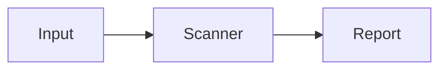

# README patterns from well-known open-source READMEs

A snapshot of what a sample of well-known READMEs do, with snippets you can copy. Use it as the default research for stage 1. Refresh it (download the READMEs again, see the end of this file) only when the user asks, when the project is a different kind of thing from the sampled ones, or when you suspect the examples are out of date. Examples name the README they came from. Treat the "used by" column as a snapshot: READMEs change.

Contents: A. Techniques, B. Section order of three well-structured READMEs, C. What not to do, D. Refreshing this research, E. A skill or plugin README.

## A. Techniques

| # | Technique | Used by | When it helps | Snippet |
|---|---|---|---|---|
| 1 | Centered hero: logo, title, one-line pitch | uptime-kuma, excalidraw, hono, fzf | Names the project at a glance | `<div align="center"></div>` |
| 2 | Badge row (shields.io) | uv, ripgrep, gum: 3 each; hono 11 | Version, license, CI at a glance | `` |
| 3 | Quick-nav row under the hero | excalidraw (Editor, Blog, Docs), bat (section links) | Jump without scrolling | `<p align="center"><a href="#install">Install</a> • <a href="#usage">Usage</a></p>` |
| 4 | Demo GIF or screenshot near the top | gum (GIF under the tagline), uv (chart), uptime-kuma (dashboard) | Shows the tool working before any install step | `` |
| 5 | Light and dark images | uv (two sources plus a fallback), excalidraw, fzf | Readable on either theme | block 5 |
| 6 | Feature list | hono (emoji lead-ins), fzf (bold lead-ins), uv (feature, real console output, doc link) | Skimmable capability list | `- **Fast**: one-line benefit` |
| 7 | Quick start of three commands or fewer | hono (1), uv (1) | First success in under a minute | block 7 |
| 8 | Collapsible sections | nuclei (a flag dump of about 290 lines), gum (three distro blocks), fzf | Hides bulk most readers skip | block 8 |
| 9 | GitHub callouts | uptime-kuma (2 WARNING), bat, nuclei, fzf (heavy use) | Flags the few things that bite | block 9 |
| 10 | Mermaid diagram | none of the sample; the awesome-readme list cites one | Diagram stays editable as text and renders on GitHub | block 10 |
| 11 | Directory tree | none of the sample; the awesome-readme list cites four | Shows where to change things | block 11 |
| 12 | Table of contents | fzf (generated), nuclei; gum has a command index | Needed past about 300 lines. A collapsed list in `<details>` counts | block 12 |
| 13 | Comparison with similar tools | ripgrep (benchmark tables, why and why not), bat (links an alternatives doc) | Answers "why this and not X" before install | block 13 |
| 14 | Footer: license and credits | nuclei, uv, gum | Closes with legal text and attribution | block 14 |

Block 5: `<picture>` with explicit sources.
````html
<picture>
  <source media="(prefers-color-scheme: dark)" srcset="docs/chart-dark.png">
  <source media="(prefers-color-scheme: light)" srcset="docs/chart-light.png">
  
</picture>
````
Put `alt` on the `` only. The media query follows the OS or browser theme, which can differ from the theme setting on GitHub. If the app has only one theme, ship one image. Do not fake the other.

Block 7: quick start. Keep one precondition line above it, such as "Needs Python 3.10 or later."
```bash
pip install tool
tool YOUR_INPUT
```

Block 8: collapsed list. Keep a blank line after `<summary>` and before the closing tag, or the fence inside renders as plain text.
````html
<details>
<summary>Debian and Ubuntu</summary>

```bash
sudo apt install tool
```

</details>
````

Block 9: callout. Types are NOTE, TIP, IMPORTANT, WARNING, CAUTION. Use two to four per README. A WARNING about a common mistake works best when it is followed by a code block showing the wrong way and labelled as such.
```md
> [!WARNING]
> Network file systems are not supported. Map to a local volume.
```

Block 10: Mermaid.
````md

````

Block 11: directory tree. One entry per line, short comment after it. A line longer than about 95 characters overflows the code block on GitHub (the column holds about 97).
````md
```text
src/
  cli/        entry point and flags
  core/       engine
  modules/    one file per data source
```
````

Block 12: table of contents. Anchors come from the heading text: lower case, punctuation dropped, spaces to hyphens, emoji dropped, repeated headings get `-1`, `-2`.
```md
## Contents
- [Install](#install)
- [Usage](#usage)
```

Block 13: comparison table. State the corpus, flags and hardware under it, and pair it with a "why you might not want this" list. Numbers below are placeholders.
```md
| Tool | Command | Time |
| ---- | ------- | ---- |
| **yours** | `yours PATTERN .` | **0.08s** (1.00x) |
| other | `other PATTERN .` | 0.27s (3.3x) |
```

Block 14: footer.
```md
## License
MIT. See [LICENSE](LICENSE).
```

## B. Section order of three well-structured READMEs

**uv**: title and hero with a light and dark chart; highlights (bullets linked to feature sections); installation (one curl line first); documentation (one line); features; one section per feature area; contributing; FAQ; acknowledgements; license. Why it works: install comes before features, and each feature shows real console output with a link to the docs for depth.

**ripgrep**: title, pitch, badges; changelog link; documentation quick links; a screenshot of real output; quick examples against other tools; why you should use it; why you should not; is it really faster; feature comparison; installation; building; running tests; related tools; vulnerability reporting. Why it works: the why and why-not pair answers the adopt-or-skip question before the reader reaches install, and the quick-links list indexes the long docs.

**gum**: title, hero with a GIF under the tagline; tutorial; installation; command index; customization; one section per command, each with the same shape (purpose, snippet, GIF); examples; contributing; feedback; license. Why it works: a working script comes before reference, every command section has the same shape, and the command index acts as a table of contents.

## C. Do not do these

1. **Sponsor copy above the install steps.** One sampled README opened with a long sponsor block of ads and promo codes before its first install command. Move sponsors below the license or into their own file.
2. **Badge overload and vanity counters.** One sampled README had a wall of badges in several rows, including a page-view counter. Another had eleven, two of them bundle size. Use three to five badges in one row, each one a reader acts on. No counts that go stale, nothing that names the repo owner.
3. **Every package manager expanded by default.** One installation section ran about 215 lines and listed about 25 package managers as open code blocks. Put the default command first and collapse the long tail. A skill or plugin with many install routes uses the matrix in section E instead.
4. **A giant inline table with malformed links.** One sampled README listed all of its modules in one very long inline table with no collapse, and some rows nested a markdown link inside a link destination, which does not resolve. Move big tables to their own file or a `<details>` block, and check link syntax.
5. **The pitch buried under chrome.** One README put its one-sentence pitch after a cover image, a language row and three badge images, with `<br><br>` spacers on top. Pitch first, then one badge row.
6. **Emoji lead-ins and marketing adjectives as a substitute for facts.** "Blazing fast" tells the reader nothing. A number, a command or an output does.

## D. Refreshing this research

Stage 1 downloads a fixed list so results stay comparable. Raw URL: `https://raw.githubusercontent.com/<owner>/<repo>/HEAD/README.md`.

| Repo | Why it is in the list |
|---|---|
| astral-sh/uv | install first, light and dark chart, feature sections with real output |
| BurntSushi/ripgrep | why and why-not, benchmark tables |
| charmbracelet/gum | GIF under the tagline, one shape per command |
| junegunn/fzf | callouts, a generated table of contents |
| sharkdp/bat | quick-nav row, links an alternatives doc |
| honojs/hono | hero, feature list, large badge row (what to trim) |
| excalidraw/excalidraw | hero with theme-aware images |
| louislam/uptime-kuma | dashboard screenshot, warning callouts |
| projectdiscovery/nuclei | collapsed flag dump, footer |

If one returns 404, skip it and say so. Save the files in a scratch folder, never in the repo. For each README record: the technique, which README uses it, a copyable snippet, and anything that should not be copied. Keep the list of problems with line references so the finding can be checked.

## E. A skill or plugin README

A skill or plugin has no screen of its own, several install routes, and an effect that happens inside someone else's agent session. Three blocks cover what the sample READMEs do not. Install sections for skills can be seen in the READMEs of `anthropics/skills`, `vercel-labs/agent-skills` and `obra/superpowers`. The hero, quick start and layout follow `readme-skeleton.md`, including its "A project with no screen" notes.

**1. Install matrix.** One row per route. Show the default route's command in the quick start, then the matrix, collapsed in `<details>` when it has more than about four rows. The Tested column is honest: write "yes" only for a route you ran and logged (the command, the date or version, and the result), and keep the log where the fact-checker can open it. A route you only read about says "documented, not run". Run the routes you can, in a throwaway location, before the draft, and hand the logs to the writer.

````md
| Route | Command | Tested |
|---|---|---|
| {{Default route}} | `{{command}}` | Yes: run on {{date}}, {{where the log is}} |
| {{Second route}} | `{{command}}` | Documented, not run |
````

**2. Install steps for an agent.** Many people paste a README into their agent and say "install this". Put a short numbered block addressed to that agent: one action per step, and a check that proves the step worked.

````md
### Install steps for an agent

1. Check that {{prerequisite}}.
2. Run `{{command}}`. Do not change the destination folder.
3. Confirm: {{a command or file that proves it installed, and what it should print}}.
4. Tell the user what you added and where.
````

**3. What the tool sends where.** A table with one row per step that makes a network request, including package installs and a push, and one row saying "nothing" for the steps that make none. Check each row against the code.

````md
| Step | What leaves the machine | To where | How to avoid it |
|---|---|---|---|
| {{Step}} | {{exactly what is sent}} | {{host}} | {{flag or setting}} |
````

Do not write that it "works with" an agent you did not run. Name only the agents in the matrix, with their Tested value.
