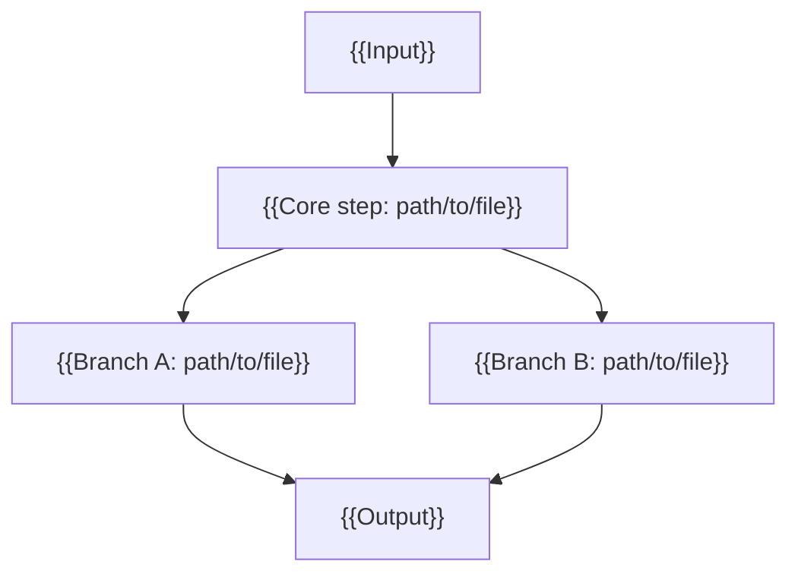

# README skeleton

A fill-in shape with the markup that rendered correctly on GitHub. Replace every `{{PLACEHOLDER}}`. Delete a section when the project has nothing true to put in it. Do not leave placeholders behind, and do not keep a section just because the skeleton has it. The last three sections of this file cover small projects, a project in a sub-folder of a larger repository, and a project with no screen.

The order is: hero, demo, who it is for, quick start, how it works, screenshots, reference, layout, development, credits, license. Depth goes late and collapsed. The first screen has to answer "what is this" and "should I keep reading".

````markdown
<p align="center">
  
</p>

<h1 align="center">{{NAME}}</h1>

<p align="center">{{ONE-LINE TAGLINE: what it does, for whom, in plain words}}</p>

<p align="center"><sub>{{OPTIONAL, ONE LINE about this README itself, for example "This README is sample output of a tool." Delete the whole paragraph when there is no such notice.}}</sub></p>

<p align="center">
   
</p>

<p align="center"><a href="#quick-start">Quick start</a> • <a href="#how-it-works">How it works</a> • <a href="#screenshots">Screenshots</a> • <a href="#reference">Reference</a> • <a href="#project-layout">Project layout</a> • <a href="#development">Development</a></p>

<p align="center">
  
  <br>
  <sub>{{CAPTION: where the demo ran, for example on an offline demo instance with fictional data}}</sub>
</p>

{{PARAGRAPH: two to four sentences. What goes in, what comes out, what it runs on, where data lives. Define each term the first time it appears.}}

## Use it when, and when not to

Use it when you want:

- **{{BENEFIT 1}}.** {{One sentence, checkable against the code.}}
- **{{BENEFIT 2}}.** {{...}}

Do not use it when you need:

- {{NON-GOAL 1}}. {{What it does instead, in one sentence.}}
- {{NON-GOAL 2}}. {{...}}

## Quick start

You need {{RUNTIME and minimum version}}. {{One sentence on anything unusual, such as "there is no build step".}}

```sh
{{COMMAND 1}}   # {{what it does}}
{{COMMAND 2}}   # {{what it does}}
{{COMMAND 3}}   # {{what it does, and where to open the result}}
```

{{ONE PARAGRAPH: the first thing to click or run, and what the reader will see.}}

> [!NOTE]
> {{A fact that prevents confusion, such as which interface it listens on.}}

{{ONE LINE: what to do if the reader has no keys, data or network, with a link to the offline route in Development.}}

## How it works

{{ONE or TWO SENTENCES that frame the diagram.}}



- **{{Component 1}}.** {{What it does, in terms of behavior you checked in the code.}}
- **{{Component 2}}.** {{...}}

### {{A second concept, with its own diagram if it has states}}

```mermaid
stateDiagram-v2
  direction LR
  [*] --> {{StateA}}: {{event}}
  {{StateA}} --> {{StateB}}: {{event}}
```

## Screenshots

<p align="center">
  <br>
  <sub>{{CAPTION}}</sub>
</p>

<p align="center">
  <br>
  <sub>{{CAPTION}}</sub>
</p>

<details>
<summary>{{Tall or secondary screenshots}}</summary>

<p align="center">
  
  &nbsp;
  <br>
  <sub>Left: {{what}}. Right: {{what}}.</sub>
</p>

</details>

## {{WHAT IT COVERS: sources, formats, platforms, commands}}

| {{Column 1}} | {{Column 2}} | {{Column 3: what it needs}} |
|---|---|---|
| {{Row}} | {{What is covered}} | {{Key, opt-in or none}} |

<details>
<summary>Full {{list}}</summary>

- **{{Group}}:** {{item}}; {{item}}; {{item}}.

</details>

{{If privacy matters: a short list titled "What leaves your machine", one bullet per destination and exactly what it receives.}}

> [!WARNING]
> {{The one thing that can surprise or harm the reader, and how it is switched on or off.}}

## Reference

### Command line

```sh
{{command}} {{args}}   # {{what it does}}
```

<details>
<summary>Options for <code>{{command}}</code></summary>

| Option | Effect |
|---|---|
| `{{--flag value}}` | {{Effect and default.}} |

</details>

### Configuration

| Setting | Variable | Notes |
|---|---|---|
| {{What}} | `{{ENV_NAME}}` | {{Required or optional, what happens without it}} |

### Where your data lives

| Path | Contents |
|---|---|
| `{{path/}}` | {{what}} |

## Project layout

```text
.
├── {{file}}               {{what it does}}
├── {{dir}}/
│   ├── {{file}}           {{what it does}}
│   └── {{file}}           {{what it does}}
└── {{dir}}/
    └── {{file}}           {{what it does}}
```

{{ONE LINE: what the tree leaves out.}}

To read the code, start with these files in order:

1. `{{path}}` {{why first}}.
2. `{{path}}` {{why second}}.

## Development

```sh
{{test command}}        # {{what it covers, and whether it needs the network}}
{{typecheck command}}   # {{what it checks}}
{{demo command}}        # {{the offline demo instance, where it listens}}
```

> [!TIP]
> {{How to try the app with no real services and no real data.}}

{{Short paragraph: how to add the most common kind of extension, naming the files to touch.}}

<details>
<summary>Retake the screenshots and the GIF</summary>

{{How: the capture config, the command, the folder it writes to, and what must be free, such as a port. Delete this block when the images were not made from a kept config.}}

</details>

## Credits

- **{{Category}}:** [{{project}}]({{url}}) ({{license}}).

## License

{{LICENSE sentence, true to the repo. If none is chosen, say so plainly.}}
````

## Markup notes

What GitHub does with this markup. Check it with `scripts/preview/render.sh`.

- **Attributes that survive:** `align`, `width`, `height`, `alt`, `src`, `href`. **`style` is stripped**, so do not rely on it for centering, colors or sizes. Use `align` and `width`.
- **Centering:** wrap in `<p align="center">` or `<div align="center">`. A markdown heading inside a centered block needs the HTML form `<h1 align="center">`.
- **Blank lines inside `<details>`:** leave one after `<summary>...</summary>` and one before `</details>`, or markdown inside will not render.
- **Images in a row:** two `` with `align="top"` and widths that add up to less than the column. The column is roughly 830 px wide on a desktop browser, so give a full-width screenshot `width="820"` or less. A wider image is scaled down to the column. A tall screenshot (over 900 px high at the width shown) goes inside `<details>` with a `width`.
- **Image weight:** keep each PNG under about 600 KB (a 256-colour PNG is fine for flat UI) and the GIF under 4 MB.
- **Badge URLs:** `https://img.shields.io/badge/<label>-<message>-<hex color>`. A hyphen in text is `--`, an underscore is `__`, a space is `%20` or `_`, and a percent sign is `%25`. A plus sign can stay as it is (`%2B` also works): `node-22+-1b6b5a` shows "node: 22+". Prefer static badges that state facts that do not change. The preview shows a placeholder for every badge, so stage 5 checks the real URL.
- **Callouts:** `> [!NOTE]`, `> [!TIP]`, `> [!IMPORTANT]`, `> [!WARNING]`, `> [!CAUTION]`. Two to four per README.
- **Mermaid:** a fenced block labelled `mermaid`. Put file paths and real names in node labels and wrap labels in quotes. Write the label at the node's first use (`a["Alpha"] --> b`). The preview's Mermaid also accepts a label added later, but an id with no label shows as plain text. Do not use these words as ids, because they fail to parse (tried with Mermaid 11.4.1): `end`, `graph`, `subgraph`, `style`, `class`, `classDef`, `call` and `href` in a flowchart, and `default` in a state diagram. Another word works (`stop`, or `End` with a capital). About ten nodes is a guide, not a limit: draw the path the code takes and split the diagram when it stops fitting a screen. When the documented thing is an instruction file, such as a skill, the nodes are the steps the file orders, each naming the file that holds it. Parse errors show up in the preview.
- **Anchors:** heading text, lower case, punctuation dropped, spaces to hyphens. "Use it when, and when not to" becomes `#use-it-when-and-when-not-to`. A heading with code in it keeps the code's text.
- **Jump links:** one row under the hero, only to sections that exist, in page order. Past about 300 lines also add a contents list. A collapsed one in `<details>` counts. Under that length the jump row is enough.
- **Code and tree lines:** keep every line under about 95 characters. The column holds about 97, and a longer line scrolls sideways. Split a long shell line with a trailing backslash. The preview names any line that is too wide.

## Sizing, and sections with nothing to say

- Size the README to the project. A small app needs a hero, a demo, a paragraph, a quick start, a short how it works, the layout and the license. A README of one-line sections looks like padding.
- Delete a section that has nothing true to put in it. Keep a negative statement only when a reader would look for the thing and be misled by silence, for example "There are no tests in this folder." Write it as one plain sentence in the section where the reader would look.
- Instructions for retaking the images go in the collapsed block at the end of Development. Delete it when the images were not made from a kept capture config.

## A project inside a larger repository

For a README in a sub-folder, such as an example or a package in a monorepo.

- The tree root is the project's own folder, written as its path from the repository root (`examples/app/`). The tree lists only that folder.
- Links to shared files count from the README's folder: `[LICENSE](../../LICENSE)`. If the folder has no license of its own, say that the repository's license covers it.
- Commands run from the project's folder. Start the quick start with `cd examples/app   # from the repository root`. Do not invent a clone URL: you may not know it, and the reader is already in the repository.
- Write paths to tools elsewhere in the repository relative to the project's folder (`../../tools/x`).

## A project with no screen

For a skill, plugin, CLI, library or other project with no UI of its own.

- Keep the hero. Under it, instead of the demo GIF, show real output of the project's own tools on a bundled example: text in a code block, or an image that the tool itself saved. Caption it exactly: "Output of `tool check example/`, unedited." Never write the output by hand or mock it up. If the tool cannot run safely and offline, leave the block out.
- When the first success happens inside an agent session, say where each step is typed. Use this shape:

````markdown
## Quick start

You need {{an agent that can load skills, and any other prerequisite}}.

In a terminal:

```sh
{{install command}}   # {{what it does, and where it puts files}}
```

In an agent session, say:

```text
{{the exact words to type}}
```

{{ONE PARAGRAPH: what the agent does next, in order, and what the reader sees at the end.}}
````

- For how it works, the diagram's nodes are the steps the instruction file orders, each naming the file that holds the step. Section E of `readme-patterns.md` covers the install matrix and the table of what a skill or plugin sends where.
